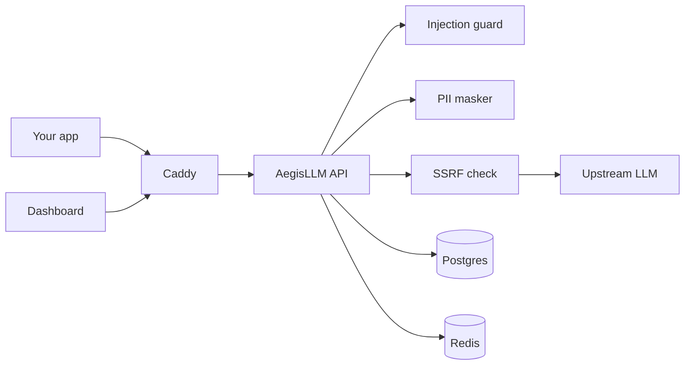

# AegisLLM

AegisLLM is a self-hosted proxy in front of OpenAI-compatible chat completions. It masks personal data before the request leaves your network, blocks a set of prompt-injection patterns, and writes an audit row for every call.

```
client  -->  Caddy  -->  AegisLLM  -->  api.openai.com
                            |   \
                            |    Redis   (auth limits, per-key limits)
                            Postgres     (users, keys, audit log)
```



The dashboard is a small React app served by the same process. The data API is under `/api`. Chat traffic is under `/v1/chat/completions` and uses a project API key, not the dashboard login.

## Quick start

Requires Docker with Compose v2.

```bash
cp .env.example .env
# Fill in POSTGRES_PASSWORD, JWT_SECRET_KEY, and FERNET_MASTER_KEY.
# The comments in .env.example have the exact commands.

docker compose up -d --build
```

Open `http://localhost`, register the first user, create a project, then add an upstream provider key in the UI. That key is encrypted with `FERNET_MASTER_KEY` and is not an environment variable.

Point a client at the proxy:

```bash
curl http://localhost/v1/chat/completions \
  -H "Authorization: Bearer $AEGIS_API_KEY" \
  -H "Content-Type: application/json" \
  -d '{"model":"gpt-4o-mini","messages":[{"role":"user","content":"hello"}]}'
```

`X-Aegis-Provider: openai` selects a provider when a project has more than one. With no header, the oldest active provider is used. Anthropic is accepted as a stored provider but `/v1/chat/completions` returns **501** for it, because that API is not the OpenAI chat shape.

### Without Docker

Use Python 3.11 or 3.12, plus Postgres 16 and Redis 7. Set `POSTGRES_HOST=localhost` and `REDIS_URL=redis://localhost:6379/0` in `.env`.

```bash
python -m venv .venv && . .venv/bin/activate
pip install -r requirements-dev.txt
alembic upgrade head
uvicorn app.main:app --reload
```

The dashboard is a separate dev server:

```bash
cd frontend && npm install && npm run dev
```

## What it does on a request

1. Authenticate the project API key. Invalid keys are 401 and are not counted.
2. Apply `RATE_LIMIT_PER_MINUTE` for that key. Over the limit is 429 with `Retry-After`. `0` turns the limit off.
3. Reject a provider that `/v1/chat/completions` does not speak (Anthropic today) with 501.
4. Score the message text for prompt injection. A block is **403** `security_policy_violation` and an audit row with `action_taken=blocked`.
5. Mask emails, phone numbers, payment cards, IBANs, a few national-id formats, AWS keys, and IPv4 addresses in the outbound body.
6. Resolve the upstream host, refuse non-global addresses (including obfuscated IP literals), and connect to the pinned address with the original `Host` and TLS SNI. Redirects are not followed.
7. Write an audit row. The masked body is what gets stored. The raw body is stored only when `STORE_RAW_PAYLOADS=true`.

Streaming responses are audited too, including when the client drops mid-stream. The stored response text is the accumulated assistant text, not the raw SSE bytes.

## Configuration

Every variable below is read by `app/core/config.py`, Compose, or the Caddyfile. `.env.example` must list each of them; CI fails when one is missing. Provider API keys are entered in the dashboard, not here.

| Variable | Default | Purpose |
|---|---|---|
| `POSTGRES_USER` | *(required)* | Database role. Compose creates it. |
| `POSTGRES_PASSWORD` | *(required)* | Database password. |
| `POSTGRES_HOST` | `db` | `db` inside Compose, `localhost` on the host. |
| `POSTGRES_PORT` | `5432` | |
| `POSTGRES_DB` | `aegisllm` | |
| `REDIS_URL` | `redis://redis:6379/0` | Shared rate-limit storage. |
| `JWT_SECRET_KEY` | *(required)* | Signs dashboard sessions. `openssl rand -hex 32`. |
| `JWT_ALGORITHM` | `HS256` | |
| `JWT_EXPIRE_MINUTES` | `1440` | |
| `FERNET_MASTER_KEY` | *(required)* | Encrypts upstream provider keys at rest. |
| `APP_NAME` | `AegisLLM` | |
| `ENVIRONMENT` | `production` | |
| `DEBUG` | `false` | `true` serves `/docs`. |
| `ALLOWED_ORIGINS` | `https://aegis.example.com` | Comma-separated CORS origins. |
| `ALLOW_REGISTRATION` | `true` | Turn off after the first account exists. |
| `ALLOWED_UPSTREAM_HOSTS` | `api.openai.com,api.anthropic.com` | Exact host allowlist. No wildcards. |
| `UPSTREAM_PRIVATE_IP_ALLOWLIST` | empty | CIDRs that may be non-public, for a model server you run yourself. |
| `PROXY_REQUEST_TIMEOUT_SEC` | `120` | |
| `MAX_REQUEST_BODY_BYTES` | `2097152` | |
| `RATE_LIMIT_PER_MINUTE` | `60` | Per API key. `0` disables. |
| `STORE_RAW_PAYLOADS` | `false` | Also store the unmasked bodies. |
| `ADMIN_EMAILS` | empty | Emails allowed to call `include_raw=true`. Each read is logged. |
| `CLEANUP_HOUR_UTC` | `3` | When the daily retention job runs. |
| `CLEANUP_MINUTE_UTC` | `0` | |
| `AUDIT_LOG_RETENTION_DAYS` | `90` | Delete audit rows older than this. `0` keeps them. |
| `CLEANUP_BATCH_SIZE` | `1000` | Rows per committed delete batch. |
| `DOMAIN` | `localhost` | Hostname Caddy serves. A public name gets automatic HTTPS. |

Project payload retention (`retention_days`, default 30) is per project in the dashboard. It deletes payload bodies and leaves the audit row. `AUDIT_LOG_RETENTION_DAYS` deletes the row itself.

Auth routes have their own limits: register 5/minute and login 10/minute, per client IP, in the same Redis.

## Threat model, short version

AegisLLM is a control in front of an LLM API. It assumes the host, the database, and `FERNET_MASTER_KEY` are yours and that callers you did not issue a key to should not get through. It does not assume the prompt text is safe, and it does not assume DNS for an allowlisted name stays pointed at a public address.

The longer write-up, including what is explicitly out of scope, is [docs/threat-model.md](docs/threat-model.md). How to report a vulnerability is in [SECURITY.md](SECURITY.md).

## Limitations

These are current behavior, not a roadmap.

- Injection detection is a phrase and normalization heuristic. On the checked-in corpus (40 attacks, 45 benign controls) it scores precision 1.00 and recall 1.00. Text that merely quotes an attack phrase is blocked too. Novel jailbreaks that do not resemble the patterns are not blocked.
- PII detection is regex plus checksums (Luhn for cards, mod-97 for IBANs, the Spanish DNI letter). It misses formats it does not know. A dotted quad is treated as an IP even when a human would call it a version number.
- The response returned to your application is the upstream response. Masking applies to what is sent upstream and to what is stored. A model that echoes a secret back will echo it to the caller.
- `/v1/chat/completions` does not speak Anthropic. The call fails with 501 before any upstream request.
- `audit_logs.timestamp` is `timestamp without time zone` and stores UTC. Filters convert aware inputs to naive UTC.
- The per-key limiter uses the synchronous Redis client inside the async request. That is the same storage slowapi uses for the auth limits.
- The Compose file runs one Uvicorn worker. Rate limits are shared through Redis, so extra workers still share a counter, but nothing here load-tests that.
- Dashboard sessions are JWTs in `localStorage`. Use HTTPS outside of localhost.
- Losing `FERNET_MASTER_KEY` makes stored provider keys unrecoverable. Leaking it together with a database dump reveals them.

## Tests

```bash
pip install -r requirements-dev.txt
pytest --cov=app --cov-report=term-missing
```

Postgres must be reachable with the `POSTGRES_*` variables (the test suite defaults to user `test`, password `test`, database `test` on localhost). Redis is used when `REDIS_URL` points at one; otherwise the limiter stays in memory.

```bash
ruff check app tests
mypy app/services/pii_detector.py app/services/injection_guard.py \
     app/services/ssrf_guard.py app/services/audit_service.py \
     app/core/config.py app/core/rate_limit.py app/core/security.py
python scripts/check_env_example.py
```

Frontend: `cd frontend && npm ci && npm run lint && npm run typecheck && npm run build`.

## License

MIT. See [LICENSE](LICENSE).
